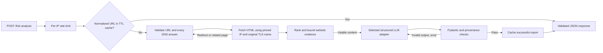
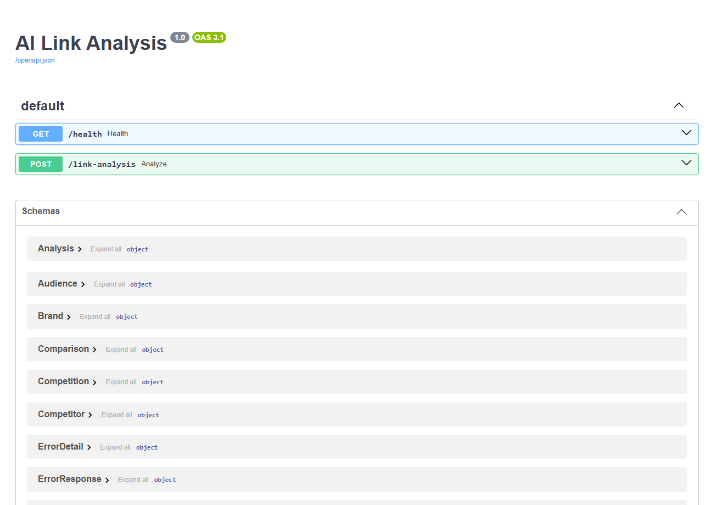

# Brandorgalytics

A FastAPI service that reads a public business website and returns a structured marketing report. One request produces a brand profile, competitor comparison, five cross-platform search queries, SEO recommendations, five service slots and audience segments. It runs in one process with no database.



## Run locally

Use Python 3.11 or newer. From the project directory, run these commands in PowerShell.

```powershell
py -3.12 -m venv .venv
.\.venv\Scripts\Activate.ps1
python -m pip install -r requirements.txt
Copy-Item .env.example .env
# Set GEMINI_API_KEY in .env using a Google AI Studio free-tier project.
uvicorn app.main:app --host 0.0.0.0 --port 4000
```

On macOS or Linux use `python3 -m venv .venv`, `source .venv/bin/activate` and `cp .env.example .env`. The hosting entry point `python -m app.main` honors `PORT` and defaults to 4000. An explicit Uvicorn `--port` takes precedence when using its CLI.

| Variable | Default | Purpose |
|---|---|---|
| LLM_PROVIDER | gemini | openai, gemini or anthropic |
| LLM_MODEL | gemini-3.1-flash-lite for Gemini | Exact model ID compatible with the adapter |
| OPENAI_API_KEY | Unset | OpenAI bearer credential |
| GEMINI_API_KEY | Unset | Gemini Developer API credential |
| ANTHROPIC_API_KEY | Unset | Anthropic Messages API credential |
| PORT | 4000 | Listener for the hosting entry point |
| CACHE_TTL | 900 | Successful result lifetime in seconds. Zero disables storage |
| RATE_LIMIT | 6 | Requests per client IP per rolling minute |

## Try the API

Open the interactive docs, expand **POST /link-analysis**, select **Try it out** and enter a public website. From PowerShell use the same request as the live sample capture.

```powershell
Invoke-RestMethod -Method Post -Uri http://localhost:4000/link-analysis -ContentType application/json -Body '{"url":"https://plausible.io/"}'
```

The success contract and all nested types appear in Swagger and `/openapi.json`. `meta.duration_ms` measures wall time for the request. Usage includes a repair generation when needed. On cache hits, usage and cost are zero and `pages_fetched` describes the cached evidence. An unpriced model returns a null cost.

### Actual request and response pairs

Plausible returned a validated report from Gemini 3.1 Flash-Lite in 13.4 seconds. The request fetched three pages and used 2,362 input and 2,262 output tokens. A repeat request hit the cache. Reviewers can read the full saved report even when the live quota is exhausted. [Successful Plausible request and response](docs/samples/analysis.json)

To refresh the samples, run `python scripts/capture_samples.py` against a running server. Failed requests are saved separately, preserving the latest successful analysis.

| Case | HTTP | Machine-readable reason | Capture |
|---|---:|---|---|
| Health check | 200 | Healthy process | [Request and response](docs/samples/health.json) |
| Invalid URL | 422 | blocked_url | [Request and response](docs/samples/invalid-url.json) |
| Loopback address | 422 | blocked_url | [Request and response](docs/samples/ssrf-block.json) |
| Unresolvable site | 502 | site_unreachable | [Request and response](docs/samples/unreachable.json) |
| Missing provider credential | 502 | llm_configuration | [Request and response](docs/samples/llm_configuration.json) |

A deadline returns 504. Local throttling or persistent provider throttling returns 429. Non-HTML, oversize pages, unusable evidence, upstream failures and exhausted schema repair return 502. Error bodies carry only `success`, `error.code` and a client-safe `error.message`.

## Benchmark

Run `python scripts/benchmark_llms.py --runs 2` from the project root with the three credentials configured. A full run schedules 18 analyses, with retries only on eligible failures. Each site is extracted once and every model receives the same evidence and system instructions. Provider-specific schema envelopes differ. The runner bypasses the application cache, retains failures, and records the prompt hash, evidence, reports, API usage, per-run costs, first-pass and final schema rates, and successful generation latency. The median requires two successful generations. The JSON file is replaced on a new benchmark. Archive earlier results first if you need a history. [Raw results](docs/benchmark_results.json)

The recorded extraction run fetched two pages from London Review Bookshop (small business), three from Plausible (SaaS) and two from Peak Design (e-commerce). Each reached high content confidence by the extractor's text-length heuristic. The saved file contains each final URL and extraction duration. Provider keys were absent for all three models. **NOT MEASURED: docs-based estimate** applies to each model. Extraction time alone cannot establish generation speed.

| Provider and model | Official standard USD per 1M input / output | MEASURED speed / schema pass / accuracy | ESTIMATED cost per cold request¹ | Context window | JSON mechanism | Recommendation |
|---|---:|---|---:|---|---|---|
| OpenAI `gpt-5.4-mini` | 0.75 / 4.50 | — / — / — | $0.0111 | 400K | Strict JSON Schema | Paid comparison option |
| Google `gemini-3.5-flash` | 1.50 / 9.00 | — / — / — | $0.0222 | 1M | responseJsonSchema | Benchmark candidate |
| Anthropic `claude-haiku-4-5-20251001` | 1.00 / 5.00 | — / — / — | $0.0130 | 200K | Forced tool input | First fallback candidate |

¹ Planning scenario of 4,000 input tokens including schema and instructions, 1,800 output tokens, standard text pricing, no cache discount and no retry. The measured-cost field uses actual API token counts and separates discounted cached input where reported. These figures exclude host charges, taxes and free-tier allowances.

Pricing retrieved November 18, 2026. [OpenAI pricing](https://developers.openai.com/api/docs/pricing) · [Gemini pricing](https://ai.google.dev/gemini-api/docs/pricing) · [Anthropic pricing](https://platform.claude.com/docs/en/about-claude/pricing)

Model specifications and interfaces. [GPT-5.4 mini](https://developers.openai.com/api/docs/models/gpt-5.4-mini) · [Gemini 3.5 Flash](https://ai.google.dev/gemini-api/docs/whats-new-gemini-3.5) · [Claude Haiku 4.5](https://platform.claude.com/docs/en/models/haiku-4-5/overview)

### Accuracy and model selection

Run `python scripts/benchmark_llms.py --grade` after the credentialed benchmark. The reviewer reads each site's saved evidence alongside the output and checks four items. Award one point each for grounded services, independently verified and relevant competitors, audience-appropriate queries and specific SEO advice. The score starts at one, giving a reproducible 1–5 scale. Grading saves each decision and the model mean, supports resuming and makes no model calls.

The six selection criteria are input price, output price, speed, accuracy, context capacity and structured output. All three have sufficient context and a structured response mechanism. Use Gemini 3.1 Flash-Lite for the demo. The saved Plausible run verifies the full endpoint with this model. Google lists free input and output for eligible projects within quota. Create a key in a free-tier project and set GEMINI_API_KEY. The API reports a standard paid-price estimate for comparison regardless of the billing tier on the key. When Gemini persistently rate-limits the demo, it returns HTTP 429 with the message “Demo quota reached, try again shortly”. The per-IP limit has a separate error code. [Google AI Studio keys](https://aistudio.google.com/apikey) · [Gemini pricing](https://ai.google.dev/gemini-api/docs/pricing)

Google applies quotas per project and model. Check the active limits in AI Studio for the key's project. Google's terms permit free-tier clients in eligible regions and require Paid Services for clients offered to users in the EEA, Switzerland or the UK. [Rate limits](https://ai.google.dev/gemini-api/docs/rate-limits) · [Terms](https://ai.google.dev/gemini-api/terms)

Benchmark speed and accuracy remain open. Expected cold response time needs a measured extraction plus generation run. Extraction has a 35-second outer deadline and generation has a separate 95-second deadline. Neither deadline is a latency prediction.

After grading, compare first-pass reliability and manual quality across **all three** site types, then evaluate median latency and actual cost among models that meet your quality requirements. Haiku is the manual fallback candidate based on price and forced tool input. Switching `LLM_PROVIDER` and clearing `LLM_MODEL` selects its default on restart. Routing stays fixed during a request to keep spend predictable.

## Cost optimization

**Implemented.** Deduplication, prioritized and bounded evidence, a 5,500-token output ceiling, one structured generation on the normal path, one shared transient retry allowance, and one schema repair. The per-process cache holds up to 256 successful URLs. A striped lock coalesces simultaneous requests for a URL when caching is enabled. A per-IP sliding window limits credit use before extraction. Its client map expires idle entries and refuses new clients at capacity.

**Suggested for a larger deployment.** Add a shared cache and rate limiter before scaling to multiple workers. Use an account-level daily spend ceiling and record production latency and quality by model before enabling automatic routing.

## Security and extraction limits

- The URL validator permits HTTP and HTTPS on ports 80 and 443. It rejects credentials, internal-looking names, ambiguous numeric hosts and nonpublic addresses. Every DNS answer must pass. Requests use the validated numeric IP, the original Host header and TLS server name. Per-hop clients disable proxy inheritance and automatic redirects. There are at most three redirects per page.
- The extractor reads static HTML with an 8-second network timeout and a 2 MiB streaming limit per page. It requests identity encoding to keep the byte limit meaningful. Up to three exact-host links can supply about, product, service or pricing details. Page metadata, headings, navigation labels, JSON-LD, footer and main content feed the prompt. The UTF-8 evidence ceiling is 8,000 bytes, a conservative upper bound for byte-based tokenizers. Typical English pages use fewer tokens.
- Website text goes into escaped, delimited data in the user message. Trusted instructions and the schema are separate. Pydantic rejects extra fields and validates counts and coverage. These controls constrain output shape. A model can still misunderstand evidence or attribute a claim to the wrong company.
- Bot challenges and empty content stop before generation. Thin usable evidence carries low confidence and instructions to acknowledge uncertainty and leave unsupported service slots unknown. Client-rendered storefronts, paywalls and compressed-only origins can fail. Competitor suggestions need independent verification. Site mentions support provenance but do not establish a commercial rivalry.
- Secrets come from the environment or a local ignored dotenv file. The Docker build copies only application code and requirements. Client errors omit credentials and upstream bodies. Anyone with access to reports can see information extracted from the submitted public website. The per-IP limiter relies on the ASGI client address. Trust forwarded headers only from your actual ingress proxy. A single shared ingress address can otherwise group users into one rate bucket.

## Verification

```shell
python -m pytest -q
```

Tests mock DNS, website HTTP and all three provider APIs. They exercise the endpoint, response validation, redirect policy, IP pinning, unsafe addresses, rate limiting, timeouts, retry and repair budgets, cache and injected website instructions. Live captures and the benchmark are separate commands.

## Deployment and live demo

### Vercel

1. Import the repository as a new Vercel project. Use the repository root as the **Root Directory**.
2. Use the **FastAPI** preset and its default install, build and output settings. Vercel installs `requirements.txt` and loads `app.main:app` on Python 3.12. Enable Fluid Compute so the function duration can cover extraction and generation.
3. In **Environment Variables**, add `GEMINI_API_KEY` as a sensitive Production variable. Set `LLM_PROVIDER=gemini` and `LLM_MODEL=gemini-3.1-flash-lite`. Add the variables to Preview as well if you want branch deployments to generate reports.
4. Deploy and open the assigned URL. The root redirects to Swagger at `/docs`. Check `GET /health`, then submit `https://plausible.io/` through `POST /link-analysis` to verify website access and the Gemini key. Redeploy after changing environment variables.

Each warm Vercel function instance has its own cache and per-IP counters. Cold starts reset both, and concurrent instances can each accept requests up to the configured limit. The saved Plausible report is available to reviewers independently of the running function. [Sample report](docs/samples/analysis.json) · [Vercel FastAPI guide](https://vercel.com/docs/frameworks/backend/fastapi)

### Docker and Render

Run the container locally with `docker build -t brandorgalytics .` and `docker run --rm --env-file .env -p 4000:4000 brandorgalytics`. The image runs as an unprivileged user and starts with `python -m app.main`.

For Render, push the project to a repository you control and create a Blueprint using `render.yaml`. Select `render.yaml` at the repository root as the Blueprint path. Set GEMINI_API_KEY in the Render dashboard. Render supplies `PORT`. Verify the health check, open Swagger and submit a public website before sharing the service.

| Environment | Base URL | API docs | Analysis |
|---|---|---|---|
| Local | http://localhost:4000 | http://localhost:4000/docs | POST http://localhost:4000/link-analysis |
| Vercel | https://brandorgalytics.vercel.app | [Try the live API](https://brandorgalytics.vercel.app/docs) | POST https://brandorgalytics.vercel.app/link-analysis |

`GET /health` verifies that the service process is responding. A successful analysis verifies website access and the configured provider.

## Screenshots

The local Swagger screenshot shows both endpoints. After configuring credentials, expand a successful response for the panel demonstration. The JSON files in `docs/samples/` preserve the full captured responses.


